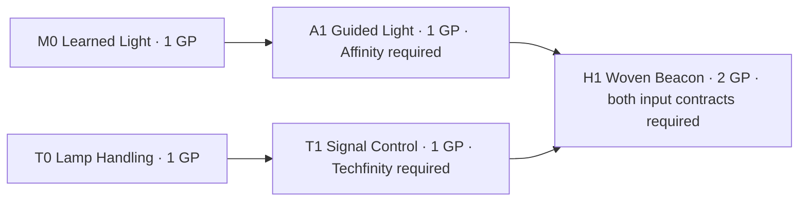

# Star Weaver skill-tree schema — proposal 0.1

**Use a directed skill graph with independent system requirements and explicit composition recipes.** Ordinary magical and technological skills remain usable without assigning them to Affinity or Techfinity. A hybrid combines named capabilities under a contract. Finity stays in review metadata and contributes no root node, rank, resource, gate, or inheritance.

Proposal ID: **SW-SKILL-001**. Source review October 21, 2026; completed October 22, 2026. All new skills, mappings, numbers, progression rules, and interaction rules below are **PROPOSED**. The reference model tests this proposal; it cannot approve canon. “Star Weaver” is treated here as the requested skill interface within **Starweaver’s Matrix**, not as a new canonical name or metaphysical entity.

**Source boundary and authority.** [CD-3, the August 30 review](https://app.notion.com/p/3cc05d32d1a5811e8e52e1306819539e) records Resolved / Accept with Changes and a later delegated resolution establishing independent Affinity and Techfinity system objects. Its old opening “Pending” callout conflicts with that resolution. The linked World Objects independently corroborate the recorded disposition: [Affinity](https://app.notion.com/p/3cc05d32d1a581878329d3cde704ba3d) and [Techfinity](https://app.notion.com/p/3cc05d32d1a581d39899c923f1002bad) have Canon status; [Finity](https://app.notion.com/p/3cc05d32d1a58156ab92e4fc9d9d5190) is Exploratory / Context Doubt. The old lexical definitions that place the axes “within Finity” are not adopted here. Native Notion verification is unverified; source authority is attributed to these explicit decision and canon fields, not to a Notion verification badge or edit timestamp.

[CD-9](https://app.notion.com/p/3cc05d32d1a58146a7fde0e9475841d3) and the [Starweaver’s Matrix object](https://app.notion.com/p/3cc05d32d1a58102b55eeab0f7af8138) support resource management, avatar editing, and spell/technology creation. They leave literal player-house ontology unpromoted. A [historical source card](https://app.notion.com/p/3e405d32d1a581249604f75a4f8a09ea) connects the Matrix to incarnation growth and player agency, but expressly does not establish current adoption or implementation. Its “DNA” language is not implemented as genetics.

The [MAGECH registry](https://app.notion.com/p/3d505d32d1a5817aadbae1890f26ffef) identifies Kernel v1.3 + Freeze Charter v1.0 as frozen and favors composition, parameters, and contracts. Its page contains registry metadata, not the full kernel. This proposal introduces software record types, not new world substances or canonical capability families. Full MAGECH conformance remains NOT_RUN until the actual kernel and charter text are available.

**Separate six records.**

| Record | Contents | Effect on play |
|---|---|---|
| Canonical system reference | ID and source for Affinity or Techfinity | Identifies an explicit access requirement; grants nothing by itself |
| Skill node | Stable ID, kind, methods, mapping, ordered ranks, activation contract | What a player can learn and perform |
| Composition recipe | Named input ports, exact node/rank/capability references, coupling and failure policy | Defines how capabilities cooperate |
| Incarnation state | Learned ranks, spending ledger, external access facts, equipment, resources, action and recovery state | Determines present availability |
| Provisional family label | Search/display label and explicit member IDs | No progression, access, or inherited effects |
| Context Doubt record | Finity and unresolved questions | Review/search only; excluded from evaluation |

The formal contract is `star-weaver.schema.json`; the five-node instance is `star-weaver.fixture.json`. Both use closed objects: unexpected fields such as `parent_system` or a global Finity rank are invalid. Semantic validation checks references, acyclicity, capability ports, cost conservation, and access unions. This is intentionally a proposal format; adoption requires a separately reviewed version rather than changing status as a side effect of learning a skill.

**Three node kinds are sufficient.**

| Kind | Definition | Progression behavior |
|---|---|---|
| `practice` | A learned procedure that does not require named-system access in this proposal | Can be learned with ordinary prerequisites and growth points |
| `expression` | A capability with one explicit Affinity or Techfinity requirement | Requires its ordinary prerequisites plus available access to that system |
| `composition` | An action that consumes two or more compatible input capabilities | Requires every input at its pinned rank and the union of their explicit system requirements |

Higher mastery is another rank on a node. A rank replaces that node’s action parameters; ranks are contiguous and learned one at a time. Refinements that change costs, duration, recovery, equipment requirements, or capability outputs are represented by rank contracts. A composition pins its input ranks, so buying a more expensive rank does not silently change an existing recipe. Version 0.1 uses flat recipes with distinct input node IDs; nested or repeated-input recipes need a later explicit extension.

Access checks are predicates rather than purchasable “system roots.” Finity, Affinity, Techfinity, the Matrix dashboard, and provisional family headings are not spendable nodes. The only progression edges are prerequisite references; the only cooperation edges are recipe input references. Neither means “is a kind of,” “contains,” or “evolves into.” All edge types together must remain acyclic in this version.

**Method and system mapping are different fields.** `methods` describes the example action using `magic`, `technology`, or their composition. These are local authoring tags, not a complete cosmology. `mapping.axis_requires` states which system access the action needs. Empty `[]` means the proposed contract deliberately requires neither system; `null` with `status: UNRESOLVED` means the author has not resolved that requirement. Never default null to an empty list.

| Proposed action pattern | Method tags | Explicit system requirements | Interpretation |
|---|---|---|---|
| Learned spell procedure | magic | `[]` | Ordinary magical skill in this fixture |
| Learned device operation | technology | `[]` | Ordinary technological skill in this fixture |
| Affinity expression | magic | `[Affinity]` | Particular proposed skill requires Affinity |
| Techfinity expression | technology | `[Techfinity]` | Particular proposed skill requires Techfinity |
| Ordinary spell + ordinary device | magic, technology | `[]` | Hybrid technique without axis requirements |
| Affinity expression + ordinary device | magic, technology | `[Affinity]` | One-axis hybrid |
| Ordinary spell + Techfinity expression | magic, technology | `[Techfinity]` | One-axis hybrid |
| Affinity expression + Techfinity expression | magic, technology | `[Affinity, Techfinity]` | Two-axis hybrid |
| Mapping not resolved | known method tags may remain | `null` | Kept for review; cannot be purchased or activated |

This is an operational boundary, not a universal claim that ordinary magic lies outside Affinity or that ordinary technology lies outside Techfinity. A character may possess either axis while performing an ordinary action. A visual resemblance, tool material, lineage, or family name never grants access. New evidence can change a proposed mapping through a versioned patch without redefining every magical or technological skill.

**Progression rules.**

1. A node rank is eligible when all listed node/rank prerequisites are learned, its mapping is specified, every required system has `available` access, and its growth-point cost can be paid. There is no hidden total-level gate or Affinity-to-Techfinity conversion.
2. The actor’s access map contains separate `available`, `unavailable`, or `unknown` values for Affinity and Techfinity. A scenario supplies these facts. The source does not yet establish whether access is innate, trained, installed, discovered, or granted through a trial; no one of those acquisition models is canonized here. Unknown access blocks affected expressions but permits explicitly ordinary skills.
3. A successful purchase deducts growth points and records the rank and actual spend together. Failure changes nothing. One request ID cannot purchase or activate twice. Learning does not generate axis access, learn another node, grant a hybrid, or activate an action.
4. Ownership persists when equipment or access is temporarily lost. Availability is computed separately. Learning needs axis access but does not require the activation equipment; using the action does. A purchased technological skill can therefore be known while its device is absent.
5. Nodes may be learned in any valid order. Both axes can progress independently; purchasing one does not reduce, replace, or raise the other. The common growth-point budget is a playtest opportunity-cost ledger, not a shared power substance or evidence for Finity.
6. Respec is allowed while no action is active. If prerequisites of an earned rank depend on the removed node, a normal refund is rejected. An explicit cascade removes the affected dependent nodes and all their earned ranks, refunding their recorded growth costs atomically. Requirements belonging only to unearned future ranks do not make a node a learned dependent. Activation resources and crafted outputs are never refunded. Recovery timers survive respec/relearning.
7. Saves preserve schema version, a mechanics digest, ranks, spent points, resources, access facts, equipment, recovery timers, active-action timing, receipts, and outputs. Compatible saves resume an interrupted action once. Incompatible mechanics require a deliberate migration; the model rejects them without changing the original save. Display labels and family metadata do not change the mechanics digest.

**Cross-axis interaction contract.** A recipe names the role of each input, the exact node and rank that provide it, and the capability token expected from that rank. For Woven Beacon, Guided Light supplies `guided_light`; Signal Control supplies `addressed_signal`; together they produce `encoded_light_beacon`. This is a proposed utility signal: the magical input provides guided light and the technological input supplies an addressed pattern. It does not define an elemental family, weapon class, or new substance.

The recipe is checked for capability compatibility, learned ranks, system availability, equipment, input recovery, and total resources before anything is charged. Its charge is the sum of its selected input actions, once. Training prerequisites do not add activation charges. Component substeps do not independently emit outputs or rewards. No default power multiplier, free energy conversion, cross-axis XP transfer, or automatic synergy is implied. More elaborate conversion or amplification needs its own explicit, reviewed contract.

Only one action runs at once in the reference test model. This is a fixture simplification, not a proposed universal action economy. The recipe and its input actions share a recovery lock during and after coupled execution, preventing the player from alternating a component and a recipe to bypass cooldowns. An unrelated ordinary practice remains separately known.

**Hybrid handling separates knowledge, readiness, and execution.**

| Situation | State / result | Resource and progression behavior |
|---|---|---|
| Composition not learned | LOCKED | No activation; prerequisite learning remains independent |
| Learned; a required mapping is unknown | UNRESOLVED | No guessed binding; preserve any stored ownership for review/migration |
| Learned; access or equipment is missing | SUSPENDED | Preserve ranks; show the missing requirement |
| Requirements met but a pool is short | DEPLETED | Debit neither pool |
| All checks pass | READY → ACTIVE | Debit the complete cost once and start the recipe |
| Inputs persist through completion | COMPLETE event → RECOVERING | Emit exactly one declared output; retain spending |
| Input access/device lost during action | ABORTED event → RECOVERING, or SUSPENDED while still missing | Emit no recipe output; keep the committed cost; preserve ranks |
| Inputs restored and recovery expires | READY | Do not restart or emit automatically; require a new player activation |

`ABORTED` and `COMPLETE` are events in the execution log; `SUSPENDED` and `RECOVERING` are computed availability states. A failed preflight has no cost or recovery penalty. A committed action pays its cost even if interrupted. The fixture provides no automatic degraded fallback: the player may later activate an independent component if its own requirements and recovery allow it. A future fallback would need an explicit output and cost contract.

“Hybrid” describes this composition, not a permanent identity, third axis, or advancement tier. A provisional hybrid family can group several recipes for display, but learning one member does not learn or authorize the others. Conflicting family names can coexist as labels without imposing a count or hierarchy.

**The smallest useful tree has five purchasable nodes.** Removing either ordinary node loses a boundary test; removing either expression loses independent axis progression; removing the composition loses the interaction test. No extra root is necessary.

Arrows mean learned prerequisites; H1 additionally binds A1 and T1 as live recipe inputs. The diagram is a player-facing graph view, not a canon containment diagram.

| ID | Kind | Required learned ranks | Axis access | Activation contract |
|---|---|---|---|---|
| M0 — Learned Light | practice | none | none | 1 focus; steady spell light; 1 tick execution, 1 tick recovery |
| T0 — Lamp Handling | practice | none | none | lamp + 1 charge; steady lamp light; 1 tick execution, 1 tick recovery |
| A1 — Guided Light | expression | M0 rank 1 | Affinity | 1 focus; guided light; 1 tick execution, 1 tick recovery |
| T1 — Signal Control | expression | T0 rank 1 | Techfinity | lamp + 1 charge; addressed signal; 1 tick execution, 1 tick recovery |
| H1 — Woven Beacon | composition | A1 AND T1 rank 1 | Affinity AND Techfinity | lamp + 1 focus + 1 charge; encoded light beacon; 2 ticks execution, 2 ticks recovery |

All five nodes have one rank in the fixture. Total learning cost is six growth points. Start with six growth points, three focus, three charge, a lamp, and both access flags available. These are test inputs, not assertions about starting characters, mana, batteries, family size, or universal balance. A tick is a discrete model step, not a canonical second. Resource regeneration and earning growth points are outside this fixture.

To test the full route, learn M0, T0, A1, T1, and H1. Points become zero. At tick 0 activate H1: both resource pools become two. Tick 1 has no completed output. Tick 2 emits one beacon and enters recovery. At tick 4 it becomes ready again. Repeat a fresh scenario with Techfinity access removed at tick 1: no beacon is emitted, both pools remain two, ranks remain learned, and the recipe is suspended. Restore access; once recovery expires, a fresh activation is required.

Boundary variants reuse H1’s recipe slot with M0+T0, A1+T0, and M0+T1 to test zero-axis and one-axis hybrids. They are alternate fixtures, not extra nodes in the minimal tree. A higher-rank variant checks that an upgraded A1 does not silently change H1’s pinned rank-1 input cost.

**Player-facing presentation.** Display ordinary procedures and the two system expressions as filters or lanes with their actual prerequisites visible. Put compositions at the connections they use. A learned node can remain filled while its availability badge says “Lamp missing,” “Techfinity unavailable,” or “Mapping unresolved.” Each card should show learning cost, use cost, input roles, expected result, recovery, and interruption behavior. Keep Context Doubt and provisional family labels in an expandable design/review panel, with no player progression attached. These are UI requirements for later integration; no UI is delivered or claimed tested here.

**Acceptance and limits.** The included verifier validates the JSON contract, runs semantic graph checks, and exercises the model. Consult `verification.json` for the actual latest result rather than treating this document as execution evidence. Expected acceptance includes ordinary skills without either axis; independent axis progression; all-or-nothing hybrid costs; interruption without rank loss; no fallback output; recovery sharing; typed input rejection; cycle rejection; explicit null handling; display-only families; respec integrity; pinned-rank behavior; and save/resume without duplicate activation.

Canon adoption and creative fit remain HUMAN_CHECK. Full MAGECH conformance, game-engine integration, rendered UI behavior, real-player readability, and balance are NOT_RUN. The fixture supplies symbolic output tokens and deterministic state transitions, not a rendered magical effect or a production save/network layer. These limits do not prevent evaluating the requested schema.

**Reviewable proposal patch.** Accepting this design for a playtest would approve only: separate method tags and system requirements; explicit ordinary-skill mappings for these examples; independent progression and temporary availability; and contract-based hybrid recipes. It would not settle the source of axis access, assign every magical or technological action to an axis, name canonical hybrid families, resolve historical family counts, establish Finity’s meaning, or promote the Matrix’s player-house ontology. No Notion pages, World Objects, Relations, or Claims were changed.

The exact next integration step is to bind the five capability tokens to a game prototype’s actual effects and feed its access/equipment/resource events into the same gates. Any canon patch remains a separate decision by Joshyua.
