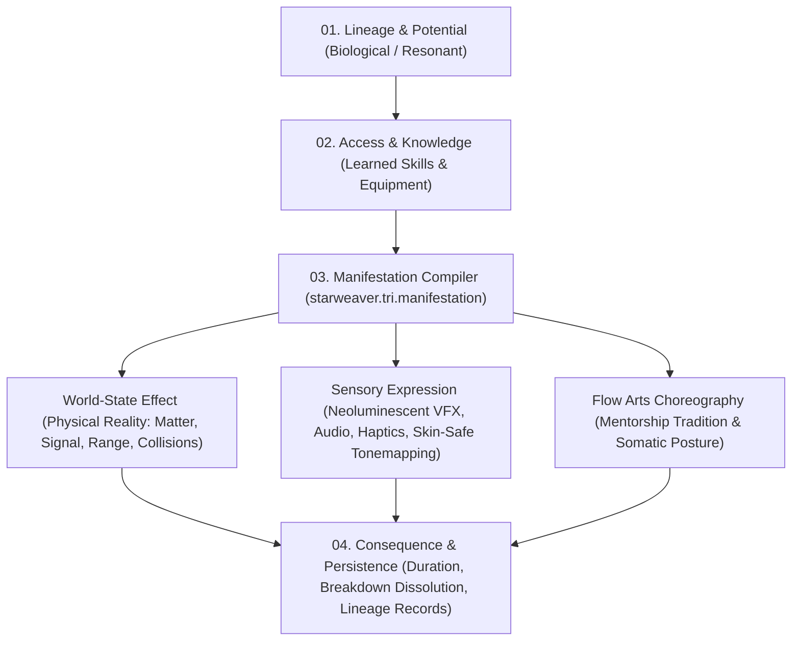
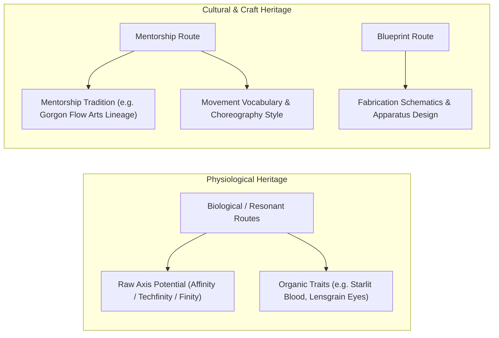

# Star Weaver v0.3.1: Manifestation & Embodiment Contract (EXPERIMENTAL)

> [!NOTE]
> **Status:** EXPERIMENTAL proposal (`SW-MANIFEST-001`).
> This contract grounds Star Weaver's power engine into the concrete physical laws, Neoluminescent visual doctrine, Aetherwear/Assorcery interfaces, and Afro-Gorgon cultural traditions of the universe.
> It introduces the **Manifestation Compiler** layer without modifying the approved v0.2 gameplay canon.

---

## 1. The Missing Architecture: Reality Compilation

In v0.2 and early v0.3, the engine evaluated learning, resource costs, and completion, outputting:
```json
{ "tick": 12, "node": "H1", "output": "encoded_light_beacon", "power": 5 }
```
While mathematically sound, that is simulation state, not a living manifestation.
The **Manifestation Compiler** closes the gap by modeling the complete chain:

$$\text{Ancestry} \longrightarrow \text{Potential} \longrightarrow \text{Experience} \longrightarrow \text{Expression} \longrightarrow \text{Materialization} \longrightarrow \text{Consequence} \longrightarrow \text{Cultural Meaning}$$



---

## 2. Neoluminescent Visual Doctrine & 7-Anchor Color Gamut

Manifestations draw from a defined seven-anchor semantic color gamut, with strict **skin-safe luminance bounds** that prevent blown-out exposures over dark complexions and preserve micro-contrast, facial planes, and material textures.

| Color Anchor | Hex Code | Semantic In-World Meaning | Skin-Safe Max Luminance |
| :--- | :--- | :--- | :--- |
| **Sorcery Magenta** | `#FF2BD6` | Sorcery, charisma, psychic signature, raw Affinity intentionality | $450\text{ nits}$ |
| **Precision Cyan** | `#00E5FF` | Scanning, precision, cybernetic thought, Techfinity addressing logic | $400\text{ nits}$ |
| **Awakening Lemon-Lime**| `#A6FF00` | Life-code, reflex, somatic awakening, kinetic flow | $380\text{ nits}$ |
| **Ancestral Solar Amber**| `#FFB300` | Authority, lineage protection, ancestral charge, grounding | $500\text{ nits}$ |
| **Rupture Red-Orange** | `#FF3D00` | Heat, consequence, rupture, emergency threshold overdrive | $320\text{ nits}$ |
| **Liminal Threshold UV**| `#7B1FA2` | Boundary, liminality, Finity convergence, dimensional interface | $280\text{ nits}$ |
| **Grounding Void Black** | `#0A0A0F` | Absorbing background, perceptual grounding, high-contrast anchor | $5\text{ nits}$ |

> [!IMPORTANT]
> **Skin-Tone Protection Doctrine:** Luminous effects must never blast direct omnidirectional white bloom onto performers. Effects utilize complementary rim-lighting (e.g. magenta along one cheekbone, cyan along the other) and inverse-square falloff, maintaining deep natural melanin undertones as the visual anchor.

---

## 3. Geometric Line Grammar

Neoluminescent Line Magic is authored through three fundamental geometric modes:

```
  Wave (Continuous Resonance)    ~~/~~\\~~/~~\\~~/~~\\~~/~~\\~~>  [Sustained Harmonic Carrier]
  Zigzag (Routed Control Logic)   |--+   +--+   +--+   +---->  [Gated Optical Modulation]
  Particle (Discrete Impulse)     . : * (BURST) * : .       [Quantized Energy Transfer]
```

- **Wave (Continuous):** Resonant harmonic oscillation. Acts as the carrier medium that binds disparate energy streams and sustains flow over time.
- **Zigzag (Routed):** Sharp angular routing with logic-gated transitions. Acts as control logic, addressing frequencies, encoding protocols, and routing data.
- **Particle (Discrete):** Localized quantum emissions and impulse packets. Delivers kinetic impacts, trigger spikes, and localized threshold readings.

---

## 4. Material Interfaces: Aetherwear vs. Assorcery

| Interface Class | In-World Reality | Equipment Role |
| :--- | :--- | :--- |
| **Aetherwear** | Bio-conductive wearable textiles, woven metallic thread conduit sleeves, skin-contact mediators. | Mediates internal somatic Affinity flow into external stable geometry. |
| **Assorcery** | Engineered hybrid magech fusion devices: optical lanterns, signal modulators, capacitor banks, relay matrices. | Intercepts, modulates, clock-times, and routes luminous carriers into technological signals. |
| **Ordinary** | Conventional non-affinity physical hardware: unaugmented oil/glass lamps, inert lenses, mechanical shutters. | Standard physical tool handling without magical coupling. |
| **Inherent** | Somatic, nervous, and ocular flow originating directly from biological or ocular anatomy. | Direct biological projection (e.g., *Learned Light* palm flow, *Threshold Sense* iris dilation). |

---

## 5. The Canonical Vertical Slice: $H_1$ Woven Beacon

$H_1$ *Woven Beacon* is the benchmark composition demonstrating how independent Affinity and Techfinity streams fuse into a physical reality structure.

### Manifestation Specification
- **Skill:** $H_1$ *Woven Beacon* (Composition of $A_1$ Guided Light + $T_1$ Signal Control)
- **Line Grammar:** `["wave", "zigzag"]`
- **Color Gamut:** `#FF2BD6` (Sorcery Magenta) + `#00E5FF` (Precision Cyan)
- **Material Channel:** `Assorcery` apparatus (`lamp`) coupled with `Aetherwear` forearm conduit
- **World-State Effect:**
  - `kind`: `encoded_light_beacon`
  - `signal_protocol`: `woven_carrier_protocol_v1`
  - `range_meters`: *null (Unquantified pending world physics laws)*
  - `collision_profile`: *null (Non-solid optical beacon)*
  - `persistence_ticks`: $2\text{ ticks}$

### Spatial Geometry & Sensorics
```
=== Manifestation Frame: Woven Beacon (H1) [Status: ACTIVE] ===
Material Interface : Assorcery (Apparatus: lamp)
Line Grammar       : WAVE + ZIGZAG
Color Gamut        : Sorcery Magenta (#FF2BD6) + Precision Cyan (#00E5FF)
Luminance Bound    : Capped at 400.0 nits (Skin-safe)
Choreography       : Gorgon Dual-Axis Orbital Weave [Polyrhythmic 3/4 wave vs 4/4 clock]

--- Spatial Geometry ---
  (MAGENTA WAVE)      ~\         /~~\         /~~\         /~
                       \  +=====+  /  +=====+  /  +=====+  
  (CYAN ZIGZAG)        +[ZIGZAG]+-[ZIGZAG]+-[ZIGZAG]+- > [ENCODED BEACON]
                       /  +=====+  \  +=====+  \  +=====+  
  (MAGENTA WAVE)      ~/         \_/~         \_/~         \_
  [Coherence Nodes]    *            *            *            * (Interference Flashes)

--- Sensory Expression ---
  Visual Form      : Double-helix light beacon: continuous magenta wave tightly braided with
                     an orthogonal, sharply stepped cyan zigzag lattice. Intersection nodes
                     flash with white-violet coherence spikes.
  Audio Signature  : Rich 440 Hz cello-like harmonic resonance layered with crisp rhythmic 2.4 kHz clock pulses.
  Haptic Feedback  : Gyroscopic counter-torque across both hands; the lamp chassis resists lateral drift.
  Skin Protection  : Complementary dual rim light (magenta on right cheekbone, cyan on left cheekbone),
                     leaving natural melanin undertones unwashed and razor-sharp.
```

### Interruption Breakdown (Hardware Loss)
When the required `lamp` is dropped or destroyed mid-activation:
- **Engine State:** Transitions to `ABORTED` with zero resource refund.
- **Breakdown Visual:** **Dissolve Lattice**. The cyan zigzag structure instantly snaps; unsupported magenta ribbons oscillate violently into turbulent eddies and dissipate as ambient warm air within 0.2s.
- **Somatic Recoil:** Sudden loss of gyroscopic torque causes the performer's hands to drop heavily; residual static discharge prickles the fingertips.
- **World Persistence:** Drops immediately to $0\text{ ticks}$.

---

## 6. Cultural Transmission vs. Biological Heredity

In v0.3.1, biological inheritance is explicitly decoupled from cultural flow arts:



- Two performers with identical potentials (e.g., $75/75$) manifest abilities with distinct movement vocabularies:
  - **Gorgon Flow Arts Lineage:** Emphasizes fluid orbital sweeps, circular wrist arrests, and polyrhythmic breathing.
  - **Foundry Artisan Guild:** Emphasizes angular stance bracing, mechanical detent tactile cues, and metronomic precision.
- Both produce the **exact same deterministic physical world effect**, but their cultural meaning, aesthetic signature, and somatic experience reflect their lived heritage.

---

## 7. Clarification of Terms: `Triune-Woven` vs. `Triune Weave`

| Concept | Classification | Requirements | Effect on System |
| :--- | :--- | :--- | :--- |
| **`Triune-Woven`** | Hereditary Potential Trait | $\ge 60$ in Affinity, Techfinity, and Finity | High cross-axis learning affinity. **Grants zero skill ranks, no equipment, and no axis access.** |
| **`Triune Weave` ($H_4$)** | Learned Progression Capstone | Requires learned ranks in $H_1$, $H_2$, $H_3$, and $3\text{ GP}$ | Executable reality synthesis lattice requiring lamp apparatus and tri-resource spending. |

A character born with *Triune-Woven* potential cannot cast $H_4$ at birth. Manifestation requires intentional study, physical equipment, and proven practice.
